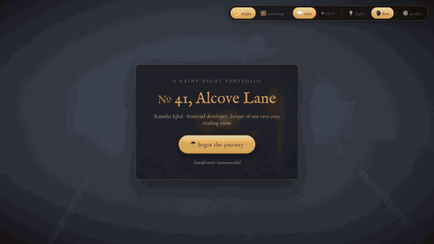

# № 41, Alcove Lane — a rainy-night portfolio

An interactive 3D portfolio. Walk in from the rain, look around a cozy reading room, and pull my portfolio off the shelf — it opens as a book you can flip through.



▶ **[Full-quality demo video (MP4, 1 min)](https://github.com/Ramsha42001/book-portfolio/raw/main/docs/demo.mp4)**

## What's inside

| Scene | What you can do |
|---|---|
| The doorstep | A rainy night at № 41 — ring the bell, lift the knocker, or push the door |
| The reading room | Walk with **W A S D**, drag to look around, follow a 6-step guided tour |
| The room's objects | Pet the dog and play fetch, light the candle and fireplace, open the curtains and window, play a song |
| The weather bar | Switch **night / morning**, **rain / clear**, **lights / dim** live |
| The portfolio book | Opens in 3D with page-turn animation; ribbon tabs jump to **Story · About · Work · Skills · School · Contact** |

## Built with

| | |
|---|---|
| UI | React 19, Vite |
| 3D | three.js, @react-three/fiber, @react-three/drei, @react-three/postprocessing (bloom, vignette) |
| Motion | framer-motion, react-pageflip |
| Sound | Synthesized with the Web Audio API — every sound is generated from noise and oscillators, no audio files |

## Run it

```bash
npm install
npm run dev        # http://localhost:5173
npm run build      # production build in dist/
```

Headphones recommended.

## Credits

- Lantern model: [Khronos glTF Sample Models — Lantern](https://github.com/KhronosGroup/glTF-Sample-Models/tree/main/2.0/Lantern) (CC0)
- Mona Lisa: public domain, via Wikimedia Commons
- Song previews: iTunes Search API
- Fonts: Cormorant Garamond, EB Garamond (Google Fonts)

---

Made by **Ramsha Iqbal** · [GitHub](https://github.com/Ramsha42001)
